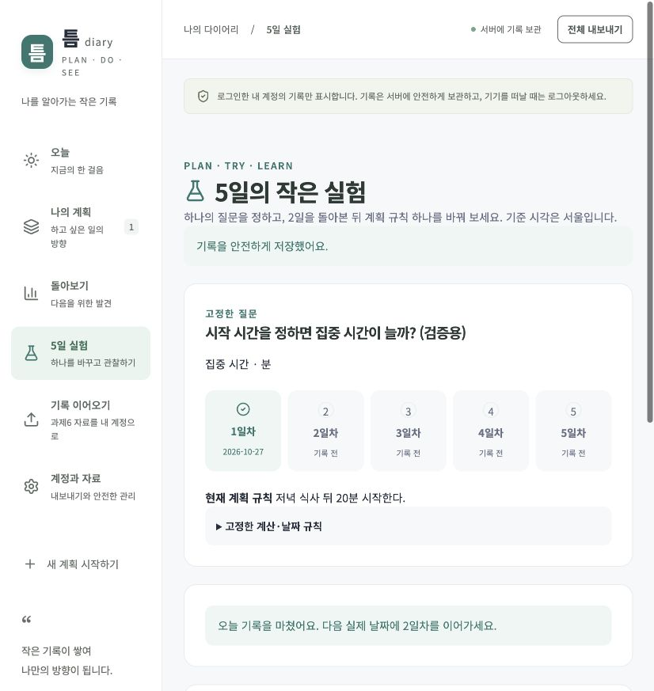

# 틈 · Plan Do See Diary 2

계획과 실제 사이의 기록을 나만의 계정에 보관하고, 하나의 계획 규칙을 바꿔 5일 동안 관찰하는 다이어리입니다.

**필수 기능과 UX A1~A7을 구현했습니다.** 과제6의 계획·할 일·실행·타이머·회고·다음 계획 연결을 계승했습니다. 실제 5일 사용은 사용자가 직접 진행해야 하며 자동 테스트나 예전 기록으로 대신하지 않았습니다.

- 로컬 앱: 실행 후 `http://127.0.0.1:5173`
- [GitHub 소스](https://github.com/jkimsvsd-code/project-apprenticeship-07)
- [과제7 앱 열기](https://pds-diary-apprenticeship-07-m2021.happybay512.chatgpt.site) · [배포 및 운영 검증](docs/deployment.md)
- [검증 결과](docs/evidence/verification-results.md) · [직접 진행할 5일 사용 절차](docs/five-day-guide.md)
- [인증 구현 설명서](docs/authentication.md) · [승인 범위](docs/scope.md) · [요구사항 대응표](docs/requirements.md)



## 구현 기능

- **과제6 계승:** 계획·수정 이력, 할 일 검색·필터·완료·삭제 복원, 타이머·시간 보정, 회고·근거·차트·다음 계획 연결.
- **인증:** Better Auth 1.7.14, scrypt, 가입·로그인·로그아웃·비밀번호 변경, DB 세션 7일 고정 만료. 로그아웃·비밀번호 변경·계정 삭제 후 이전 인증값 거절.
- **자료 보호:** 서버 인증을 기준으로 목록·한 건·변경·관련 자료·집계·내보내기·중복 요청 처리를 분리. 다른 계정 자료는 404.
- **A1:** 비밀번호 표시 전환·자동완성·입력 오류 안내.
- **A2:** 과제6 JSON 미리보기·관계/시각 보존·계정 귀속·중복 이전 방지·실패 시 전체 되돌림.
- **A3~A5:** 질문·지표·단위·계산 규칙 설정, 실제 서울 날짜별 진행, 2일차 뒤 규칙 하나 변경, 전 2일/후 3일 비교·근거·검산.
- **A6:** 만료 후 같은 계정으로 재로그인하면 같은 화면의 미저장 입력 유지. 계정 전환과 로그아웃은 이전 입력을 비우며 다른 탭에도 알림.
- **A7:** 본인 자료 전체 JSON 내보내기, 삭제 범위·복구 불가 안내, 비밀번호 재확인 뒤 계정과 연관 자료·세션 영구 삭제.

## 로컬 실행

Node.js 24 이상, npm을 사용합니다.

```sh
npm ci
npm run setup:local
npm run db:migrate
npm run dev
```

`http://127.0.0.1:5173`을 열고 본인이 계정을 만듭니다. `setup:local`은 Git에서 제외되는 `.dev.vars`에 로컬 전용 비밀값을 생성합니다. 실제 비밀번호를 문서나 이슈로 보내지 않습니다.

로컬 DB는 `.wrangler/state`에 유지됩니다. 로컬과 배포 DB는 별개이고 테스트 계정·개인 백업은 배포하지 않습니다. 새 체크아웃에는 개인 자료가 없습니다.

## 검증

```sh
npm run typecheck
npm test
npm run db:check
npm run build
```

로컬 개발 서버와 테스트 DB를 실행한 상태에서만 다음을 실행합니다. 폐기용 A/B 계정을 만들고 검증 후 삭제합니다.

```sh
npm run test:http:auth
```

과제6 회귀 검증을 포함한 단위·SQLite 통합 테스트 22개, 실제 로컬 Worker 증거 61건, 배포된 운영 Worker의 인증·자료 보호 검증 73건을 확인했습니다. 운영 검증용 A/B 계정과 자료는 모두 삭제했습니다. 브라우저에서는 로그인, 자료 이전, 실험 설정·기록, 만료 후 입력 복귀, 계정 관리 안내를 확인했습니다. [세부 결과와 한계](docs/evidence/verification-results.md)

## 기존 자료와 실제 사용

과제6 앱과 DB는 변경하지 않았습니다. 현재 자료는 계획 2개·할 일 5개·실행 3개·회고 1개, 실행 시간 합계 75분임을 확인하고 로컬 비공개 백업으로 보존했습니다. 백업 원본은 Git에 포함하지 않습니다.

2026-10-27 본인 계정의 실제 자료 이전 완료를 운영 DB에서 확인했습니다. 계획 2개·수정 이력 2개·할 일 5개·실행 3개·회고 1개와 실행 합계 75분, 회고와 다음 계획 연결이 본인 소유로 보존됐습니다. ID는 계정별로 다시 매핑합니다. [개인정보를 제외한 확인 근거](docs/evidence/completion-review.md)

‘5일 실험’의 질문·지표·단위·계산 규칙은 본인 계정에 저장됐고 실제 일별 기록은 0/5일입니다. 실제 날짜 5일을 사용하고 **2일차 기록 뒤, 3일차 기록 전에 규칙 하나를 변경**합니다. [하루씩 따라가는 절차](docs/five-day-guide.md) · [실제 값·수동 검산 양식](docs/evidence/experiment/manual-check.md)

## 구조와 공개

`app`은 화면/API 진입점, `src/features`는 사용자 흐름, `src/server`는 인증·소유권·자료 관리, `db`와 `drizzle`은 DB 선언·마이그레이션, `contracts`는 계약, `tests`는 검증, `docs/evidence`는 마스킹한 공개 증거를 담당합니다. [전체 파일 트리](docs/structure.md) · [설계](docs/architecture.md)

- 과제6 기준 커밋 `53ee04f3d3865e89fde664f56bca93d614057560`과 조상 이력을 보존했습니다. 과제6 문서·증거는 `docs/baseline/t06`에 있습니다.
- `.openai/hosting.json`에는 과제7의 공개 가능한 Site ID와 바인딩만 둡니다. 실제 키는 로컬 `.dev.vars`와 호스팅 환경에만 보관합니다.
- `.env`, DB·덤프·내보내기·원시 캡처·개인 백업·원본 과제 PDF는 커밋하지 않습니다.
- [GitHub public 소스](https://github.com/jkimsvsd-code/project-apprenticeship-07): 과제6 Git 이력을 그대로 유지합니다. 개인 백업·비밀값·전체 비밀번호 해시는 포함하지 않습니다.
- 이메일 확인·비밀번호 찾기·MFA·분산 무차별 대입 방어 등 남은 한계는 [설명서 ⑥](docs/authentication.md)에 명시했습니다.
- 라이선스는 미선택입니다.

[문서 안내](docs/README.md) · [기여 안내](CONTRIBUTING.md) · [보안 안내](SECURITY.md)
