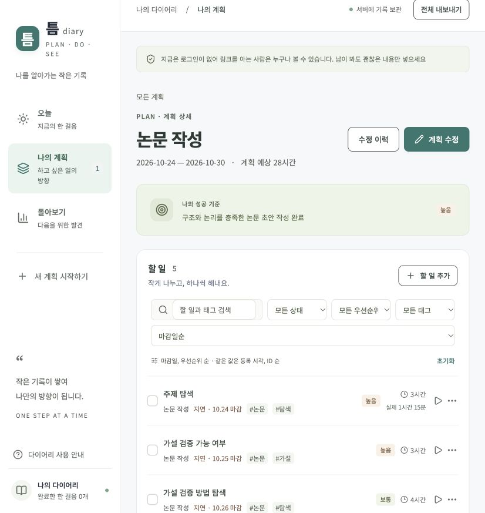

> 과제6 기준 커밋 `53ee04f3d3865e89fde664f56bca93d614057560`의 보존 문서입니다. 과제7의 구현·검증 결과를 의미하지 않습니다. 상대 링크는 현재 보존 위치에 맞게 조정했습니다.

# 틈 · Plan Do See Diary

계획과 실제 사이, 나를 알아가는 기록.

[공개 다이어리 열기](https://pds-diary-apprenticeship-06-m2021.happybay512.chatgpt.site)

[GitHub 소스](https://github.com/jkimsvsd-code/project-apprenticeship-06) · [과제 제출 문서](submission.md) · [회고·다음 계획 작성 안내](usage.md) · [검증 결과](evidence/verification-results.md)



**계획 → 할 일 → 실행 기록 → 돌아보기 → 다음 계획**을 연결하는 과제6 다이어리입니다. 필수 기능과 승인된 UX 개선 A·B 전체를 구현했습니다.

## 구현 기능

- **Plan**: 기간·우선순위·성공 기준·예상 시간, 최초 계획 보존, 버전별 수정 전후 비교
- **Task**: 생성·수정·완료·완료 취소·논리 삭제·삭제 실행 취소, 검색·필터·안정적인 정렬, 연속 빠른 추가
- **Do**: 서버에 보존되는 타이머, 수동 실행 기록·시간 보정, 막힌 이유, 완료 중복 방지
- **See**: 기간별 정확한 집계, 모든 숫자의 근거 목록, 예상·실제 비교 차트와 표, 개선점 저장·다음 계획 도우미
- **Today**: 오늘 마감·기한 경과·현재 실행 중인 할 일
- **보존·사용 편의**: 서버 DB 저장, 새로고침 복원, 전체 JSON 내보내기, 저장 상태·오류·재시도·입력 유지, 모바일·키보드 대응, URL 조회 조건 유지

## 실행

Node.js 24 이상을 권장합니다. 데이터베이스는 서버 측 Cloudflare D1(SQLite)입니다. 로컬에서는 Wrangler가 실제 SQLite 데이터베이스를 `.wrangler/state`에 보존합니다. 브라우저 저장소에 기록을 보관하지 않습니다.

```sh
npm ci
npm run db:migrate
npm run dev
```

터미널에 표시되는 로컬 주소를 엽니다. 기본 주소는 `http://127.0.0.1:5173`입니다. 로컬 DB와 배포 DB는 별개이며, 새 체크아웃은 빈 다이어리로 시작합니다.

```sh
npm run typecheck
npm test
npm run db:check
npm run build
```

`npm test`는 Node SQLite에 실제 마이그레이션을 적용해 계산 규칙·관계·제약·트랜잭션을 검증합니다. 로그인 기능과 외부 API 키 없이 실행됩니다.

## 구조

| 위치                           | 역할                                                   |
| ------------------------------ | ------------------------------------------------------ |
| `app`                          | 페이지 진입점, 전역 스타일, `/api/diary`·`/api/export` |
| `src/features`                 | 계획·할 일·실행·돌아보기·오늘 화면                     |
| `src/components/ui`            | 모달·빈 상태·폼 오류 공통 UI                           |
| `src/server`                   | 서버 DB 처리·입력 검증·중복 방지                       |
| `src/shared`                   | 데이터 타입·날짜·집계·정렬·클라이언트 통신             |
| `db/schema.ts`                 | Drizzle 스키마 선언                                    |
| `drizzle`                      | Sites가 배포 시 적용하는 SQL 마이그레이션과 스냅샷     |
| `contracts/pds-schema-v2.json` | 실제 테이블·관계·제약·날짜·집계 계약                   |
| `tests`                        | 규칙·저장소·실제 HTTP 경계 검증                        |
| `docs`                         | 승인 범위·설계·검증·제출 문서와 증거                   |

초기 구조의 `db/migrations` 대신 Sites 공식 빌드가 인식하는 `drizzle`을 마이그레이션 위치로 사용합니다.

## 데이터 규칙

- 날짜·마감 판단은 **Asia/Seoul**, 시각 저장은 **UTC**, 소요 시간은 **정수 분**입니다.
- 돌아보기의 ‘계획 수’는 계획 문서 수가 아닌 **삭제되지 않은 할 일 수**입니다.
- 기간은 **할 일 마감일** 기준이며, 실제 시간은 대상 할 일의 모든 실행 기록 합계입니다.
- 타이머는 경과 시간을 올림해 최소 1분으로 저장합니다. 수동 보정은 시각 차이와 다를 수 있습니다.
- 완료 취소는 현재 완료 수를 줄이되 과거 실행 기록은 보존합니다.
- 삭제는 복원할 수 있으며, 내보내기에는 삭제 표시·수정 이력·실행·회고 연결까지 포함합니다.

## 공개와 배포

2026-10-27 사용자 승인에 따라 **공개 전환을 완료했습니다.** 논문 계획과 실행 기록을 포함해 링크를 아는 누구나 로그인 없이 조회·수정할 수 있습니다. 인증 정보·쿠키 없이 화면 조회, 기존 할 일 저장, 전체 내보내기가 성공한 것을 확인했습니다. [배포 상태와 공개 범위](deployment.md)를 참고하세요.

이 앱은 로그인이 없는 공동 공개 다이어리입니다. **주소를 아는 사람은 기록을 조회하고 변경할 수 있습니다.** 공개 가능한 본인 자료만 입력합니다. 로그인과 잠금은 과제7 범위입니다.

Sites의 서버 Worker와 D1 바인딩을 사용합니다. 배포 시 `.openai/hosting.json`의 Site ID·DB 선언을 사용하고, 새 프로젝트를 만들 때는 자신의 Site를 등록해 ID를 바꿔야 합니다. 키·Git 인증 토큰을 이 파일에 넣지 않습니다.

- 비밀값·실제 `.env`·DB 파일·원본 내보내기 파일·로컬 실행 자료는 커밋하지 않습니다.
- 이 앱 자체에는 사용자 API 키가 필요하지 않습니다.
- 원본 과제 PDF는 공개 저장소에 포함하지 않습니다.
- 라이선스는 아직 선택하지 않았습니다.

## 문서

[승인 범위](requirements.md) · [구조와 데이터 설계](architecture.md) · [UI 방향](design.md) · [검증 계획](verification.md) · [검증 결과](evidence/verification-results.md) · [과제 제출 문서](submission.md)

## 실제 사용 자료와 제출 상태

사용자가 제공하고 확인한 논문 작성 계획 1개, 할 일 5개, 실행 기록 3개를 배포 DB에 저장했습니다. 기간은 2026-10-24~10-30, 예상 시간은 28시간, 실제 기록 합계는 75분입니다. 세 기록 모두 주제 탐색에 연결되어 있습니다. 할 일별 초기 시간·마감 배분은 수정 가능한 초기값입니다.

**사용자 승인에 따라 실제 회고 저장과 다음 계획 연결까지 완료했습니다.** AI가 제안하고 사용자가 실제 회고로 채택한 문장은 다음과 같습니다.

> 탐색 범위를 연구 질문 하나로 좁히고, 다른 일에 밀리지 않도록 매일 30분을 먼저 확보하겠다.

[‘논문 작성’의 실제 회고](https://pds-diary-apprenticeship-06-m2021.happybay512.chatgpt.site/?view=review&plan=ca91d37f-d130-4e1c-9921-d485ca8c9b71)에서 [‘논문 작성 2차’ 계획](https://pds-diary-apprenticeship-06-m2021.happybay512.chatgpt.site/?view=plans&plan=b918f193-8a6a-4332-92fe-06587dafc66f)으로 연결됩니다. 2차 기간은 **2026-10-31~11-06(7일)**이며, 기존 성공 기준과 예상 시간 28시간을 이어받았습니다. 새 계획에서도 이전 회고 문장을 확인할 수 있습니다.

공개 DB에는 계획 2개·할 일 5개·실행 기록 3개·회고 1개가 저장되어 있습니다. 2차 계획에 할 일이나 과거 실행 기록을 복사하지 않았으며, 기존 실행 기록 합계 75분은 유지됩니다. 이로써 실제 사례의 Plan → Do → See → 다음 Plan 연결을 완료했습니다.
